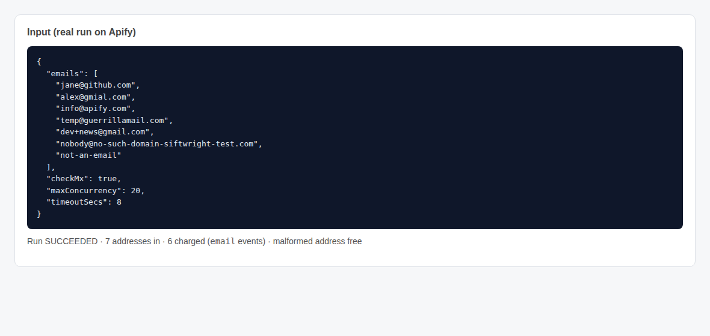
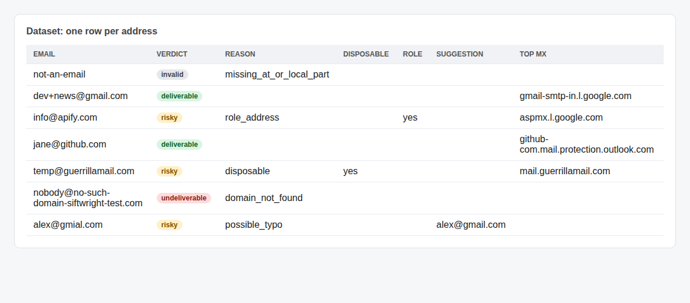
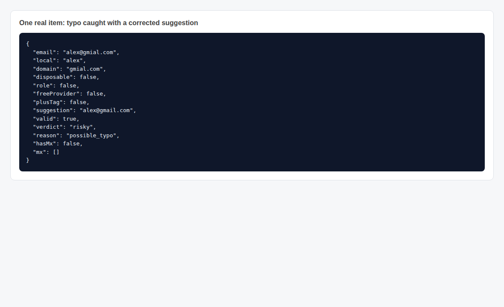

# Bulk Email Validator

**▶ [Run it on Apify](https://apify.com/siftwright/email-validator-mx-disposable)** · Examples: [Python, JavaScript & curl](examples/) · Built by [Siftwright](https://siftwright.com)

Clean an email list before you send. For every address you get one JSON row with a **verdict** (`deliverable`, `risky`, `undeliverable` or `invalid`), the **reason**, the domain's **live MX records**, and flags for **disposable** domains, **role** addresses (info@, support@), **free providers** and **likely typos** with a corrected suggestion (`someone@gmial.com` → `someone@gmail.com`).

It checks syntax and the domain's DNS mail routing. It does **not** open SMTP connections to mailboxes (see Limits), so it is fast, deterministic and cheap.





## What you get

| Field | Meaning |
|---|---|
| `verdict` | `deliverable`, `risky`, `undeliverable`, `invalid` or `unknown` |
| `reason` | `domain_not_found`, `no_mail_server`, `null_mx`, `disposable`, `possible_typo`, `role_address`, `invalid_local_part`, ... |
| `valid` | Whether the domain can receive mail at all |
| `mx` | Up to 5 MX hosts with priority |
| `disposable`, `role`, `freeProvider`, `plusTag` | Flags |
| `suggestion` | Corrected address when the domain looks mistyped |

## Real output

Input: 7 addresses (one malformed). Real run on Apify, same run as the screenshots above:

| email | verdict | reason |
|---|---|---|
| jane@github.com | deliverable | |
| dev+news@gmail.com | deliverable | |
| info@apify.com | risky | role_address |
| temp@guerrillamail.com | risky | disposable |
| alex@gmial.com | risky | possible_typo (suggests alex@gmail.com) |
| nobody@no-such-domain-siftwright-test.com | undeliverable | domain_not_found |
| not-an-email | invalid | missing_at_or_local_part |

6 of the 7 rows were charged (the malformed address was free).

## Pricing

Pay per event: **$0.80 per 1,000 emails** ($0.0008 each) plus Apify's $0.00005 start event.
- Charged once per unique address that gets a definitive verdict.
- **Free:** invalid syntax, duplicates, and inconclusive DNS lookups (timeouts/SERVFAIL).
- Set a maximum cost per run and the Actor stops exactly at the limit.

## How it compares

| | This Actor | Typical SMTP-probe verifiers |
|---|---|---|
| Price per 1,000 | $0.80 | $0.85-$2.50 plus start fees on some |
| Detects disposable / role / typos | Yes | Varies |
| Mailbox-level check | No | Sometimes |
| Failed lookups free | Yes | Varies |

## Limits (honest)

- **No mailbox-level verification.** `deliverable` means the address is well-formed and its domain publishes mail routing. It cannot confirm that a specific inbox exists; many providers (Gmail, Microsoft 365) block or mask SMTP probes, and outbound port 25 is typically blocked on cloud hosts.
- The disposable-domain list is a hand-maintained best-effort list of several hundred well-known services, not an exhaustive database; new throwaway domains appear daily.
- Catch-all domains look `deliverable`.

## Use it from code

```python
from apify_client import ApifyClient
client = ApifyClient("<APIFY_TOKEN>")
run = client.actor("siftwright/email-validator-mx-disposable").call(run_input={"emails": ["jane@github.com", "someone@gmial.com"]})
# apify-client 3.x; on 2.x use run["defaultDatasetId"]
for row in client.dataset(run.default_dataset_id).iterate_items():
    print(row["email"], row["verdict"], row["reason"])
```

```bash
curl -X POST "https://api.apify.com/v2/acts/siftwright~email-validator-mx-disposable/run-sync-get-dataset-items?token=<APIFY_TOKEN>" \
  -H "Content-Type: application/json" -d '{"emails":["jane@github.com","someone@gmial.com"]}'
```

Works with Apify's MCP server, so AI agents can call it as a tool.

## FAQ

**Why is `info@apify.com` "risky"?** Role addresses are shared inboxes: valid, but they rarely reach a person and hurt cold-email metrics.
**Do you store my list?** No. Input and results live in your own Apify run storage.

Built by [Siftwright](https://siftwright.com). Questions: support@siftwright.com.
