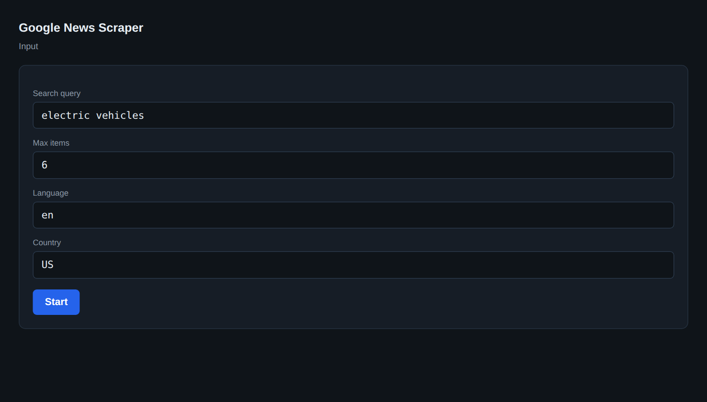
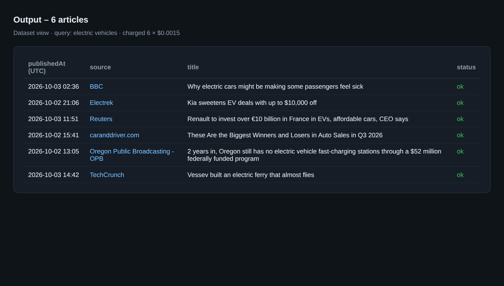
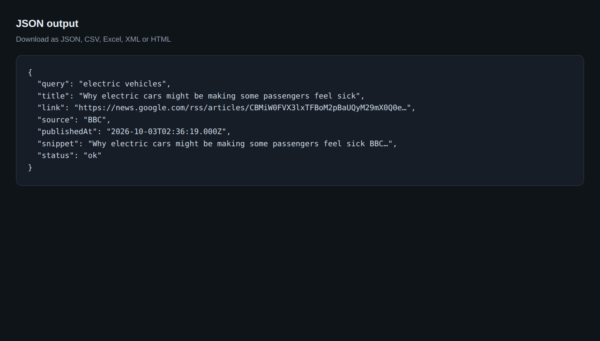

# Google News Scraper – Search Results as JSON/CSV

**▶ [Run it on Apify](https://apify.com/siftwright/google-news-scraper)** · Examples: [Python, JavaScript & curl](examples/) · Product page: [siftwright.com/google-news-api/](https://siftwright.com/google-news-api/)


Search **Google News for any keyword, topic or brand name** and get back real article results — title, source, published date, link and snippet — as clean, structured data. No proxies, no browser, no blocked requests: just fast, reliable news search results ready for JSON, CSV, Excel or your API pipeline.

**Price: $0.0015 per article result** ($1.50 per 1,000). You only pay for articles actually returned — an empty or failed search costs **$0**.

## Why choose this Actor

| | This Actor |
|---|---|
| 💵 **Price** | Pay only per article result, no monthly rental |
| 🛡️ **Pay only for success** | Empty searches and failed requests cost **$0** |
| ⚡ **Fast & lightweight** | No browser, no proxy required — just a direct RSS fetch |
| 🌍 **Any language / country** | Search any Google News edition (`language` + `country`) |
| 🧹 **Deduped results** | Repeated/syndicated stories are automatically removed |
| 📅 **Structured dates** | Publish dates normalized to ISO 8601 |
| 🤖 **AI-agent ready** | Callable from Claude, ChatGPT & Cursor through Apify's MCP server |

## What you can use it for

- 📰 **Media monitoring** – track every article mentioning your brand, product or competitor.
- 🤖 **AI & RAG pipelines** – feed fresh, real news headlines and snippets into an LLM or vector database.
- 📈 **Market & trend research** – see how coverage of a topic changes day to day.
- 🔍 **SEO & PR tracking** – find every outlet that picked up a story or press release.
- 🗂️ **Newsletter & content curation** – pull the latest headlines on a topic automatically.

## Features

- ✅ Search **any keyword, phrase or brand name**
- ✅ Any **language** and **country edition** of Google News
- ✅ Returns **title, link, source, publishedAt (ISO 8601), snippet** per article
- ✅ Automatic **deduplication** of repeated/syndicated stories
- ✅ Configurable result cap (`maxItems`, up to 200 per run)
- ✅ No proxy or browser required — fast, direct RSS fetch
- ✅ Empty or failed searches are **never charged**

## How to use

1. Click **Try for free**.
2. Enter a **search query** (keyword, topic or brand name).
3. (Optional) set `maxItems`, `language` and `country`.
4. Click **Start** and download your results from the **Output** tab.

## Screenshots







Screenshots are from a real test run (query "electric vehicles", 6 articles).

## Input example

```json
{
  "query": "artificial intelligence",
  "maxItems": 5,
  "language": "en",
  "country": "US"
}
```

| Field | Description |
|---|---|
| `query` | Search term, phrase or brand name (required) |
| `maxItems` | Maximum number of articles to return (default `30`, max `200`) |
| `language` | Google News language code, e.g. `en`, `es`, `de` (default `en`) |
| `country` | Google News country/edition code, e.g. `US`, `GB`, `IN` (default `US`) |

## Output example

Real output from a test run against the query `"artificial intelligence"`:

```json
{
  "query": "artificial intelligence",
  "title": "Bill Gates says unchecked AI could 'cause a billion deaths' in call for regulation",
  "link": "https://news.google.com/rss/articles/CBMingFBVV95cUxNX3U0dW9FbGNsVVd0bGt4MlRzRTBZMkE2NWZOYUZlUkxOd3puUEwxdkR1YXNIaHdFNUtaYzJ3cGlOTHM2ckdBbHhLZmYtbUlnalJ2QmZYVS00RFROaksyY01xUnRCSXFzcEppNElYd1NOV21KNWJXVEVPVHBVZUppSEZPRVQzVmhtdlA4ZWp4emlaQmwxblpxVjRVWGM0dw?oc=5",
  "source": "The Guardian",
  "publishedAt": "2026-09-27T09:00:00.000Z",
  "snippet": "Bill Gates says unchecked AI could 'cause a billion deaths' in call for regulation The Guardian Bill Gates warns AI could be used to trigger 'a billion deaths,' urges regulation abc45.com Bill Gates says getting countries to agree on AI regulations will be harder than Cold War-era nuclear negotiations NBC News",
  "status": "ok"
}
```

Note: Google News' RSS feed doesn't provide a separate article summary — `snippet` reflects the headline text and related-coverage outlets as published in the feed, not independently written summary text.

## Pricing

Pay-per-event: **$0.0015** per article result returned ($1.50 per 1,000). No monthly rental, no charge for empty or failed searches. Apify's free plan gives you monthly credits so you can try it for free.

## Quick start in Python

```python
from apify_client import ApifyClient

client = ApifyClient("YOUR_APIFY_TOKEN")
run = client.actor("siftwright/google-news-scraper").call(run_input={
    "query": "artificial intelligence",
    "maxItems": 30,
})
# apify-client 3.x; on 2.x use run["defaultDatasetId"]
for item in client.dataset(run.default_dataset_id).iterate_items():
    print(item["publishedAt"], item["source"], item["title"])
```

## Use it via API

```bash
curl -X POST "https://api.apify.com/v2/acts/siftwright~google-news-scraper/run-sync-get-dataset-items?token=YOUR_TOKEN" \
  -H "Content-Type: application/json" \
  -d '{"query":"artificial intelligence","maxItems":30}'
```

Works with Python and JavaScript API clients, Make, Zapier, n8n, LangChain and LlamaIndex. **AI agents** (Claude, ChatGPT, Cursor) can call it directly through [Apify's MCP server](https://mcp.apify.com).

## FAQ

**Does it use Google's official News API?** No — there is no official Google News API for this. The Actor reads Google News' public RSS search feed, the same feed available to any RSS reader, and returns it as structured data.

**Why did a query return 0 results?** Very obscure or misspelled queries can return no matching articles. Empty result sets are never charged.

**Can I search a different country or language edition?** Yes — set `language` and `country` to any Google News-supported combination, e.g. `language: "de", country: "DE"`.

**Something broke or you need a feature?** Open an issue on the **Issues** tab — we respond fast.
